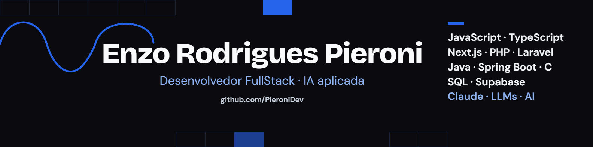

  

# Enzo Rodrigues Pieroni

**Desenvolvedor FullStack · IA aplicada**
Cofundador da B4C (Bridges4Care) · Ciência da Computação no IFMG, Campus Formiga

Construo aplicações web completas, do banco de dados e infraestrutura à entrega. Com fluxo de desenvolvimento em IA;

---

## Sobre mim

- Cofundador e desenvolvedor da **B4C**, startup de tecnologia para apoiar famílias de crianças no espectro autista
- Vencedor do prêmio de **Incubação de Inovação em Formiga (2025)**
- Formando em Ciência da Computação e Técnico em Informática pelo **IFMG, Campus Formiga**
- Freelancer: sites e sistemas sob medida para clientes
- Procurando: [vagas / projetos freelance / parcerias]

---

## Stack

**Front-end e mobile**

**Back-end**

**Dados e ferramentas**

**IA e automação:** LLMs, Claude Code, sistemas multiagentes **

---

## Vamos conversar

